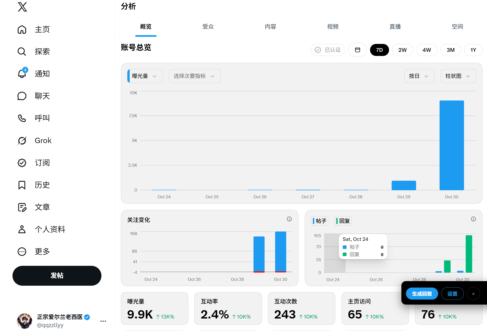

# X 创作者数据中文汉化

把 X（Twitter）**创作者工作室 / 账号数据分析**（`/i/account_analytics`）里仍是英文的指标、图表标题、时间范围等，汉化成简体中文。

通用界面汉化（侧栏、按钮等）请继续用现成方案；本扩展只补 **Analytics 数据页** 缺失的词条。

## 效果截图



## 和通用汉化的关系

| 用途 | 推荐 |
|------|------|
| 整站 UI（时间线、设置、侧栏） | [Twitter (X) 中文汉化插件](https://greasyfork.org/scripts/543260-twitter-x-%E4%B8%AD%E6%96%87%E6%B1%89%E5%8C%96%E6%8F%92%E4%BB%B6)（油猴） |
| 源码参考 | [wjm13206/x-i18n-plugin](https://github.com/wjm13206/x-i18n-plugin)（原 k1995 仓库已 404） |
| 创作者数据页指标 / 图表 | **本项目**（Chrome 扩展或同目录 `userscript.js`） |

两者可同时开：通用插件管别处，本插件管数据页。

## 覆盖示例（截图常见英文）

- Account overview → 账号总览  
- Impressions → 曝光量  
- Follows over time → 关注变化  
- Posts / Replies → 帖子 / 回复  
- Engagement rate / Engagements → 互动率 / 互动次数  
- Profile visits → 主页访问  
- New follows / Unfollows → 新关注 / 取消关注  
- Content / Audience → 内容 / 受众  
- Past 7 days / Past 28 days / Past 3 months / Past year → 近 7 天 / 近 28 天 / 近 3 个月 / 近一年  
- Bookmarks / Likes / Reposts → 书签 / 喜欢 / 转帖  
- Detail expands / Link clicks → 详情展开 / 链接点击  
- Video views / Media views → 视频观看 / 媒体观看  
- View post analytics / Export → 查看帖子数据 / 导出  

策略：**仅当文本节点整段（trim 后）等于词典键时才替换**，避免误伤数字、@ 用户名、已是中文的文案。

## Chrome / Edge 安装（未打包扩展）

1. 解压本 zip，或直接使用本文件夹 `x-analytics-zh/`  
2. 打开 `chrome://extensions`（Edge：`edge://extensions`）  
3. 右上角打开「开发者模式」  
4. 点「加载已解压的扩展程序」→ 选中本文件夹  
5. 打开 [创作者数据](https://x.com/i/account_analytics) 刷新即可  

一句话：`chrome://extensions` → 开发者模式 → 加载已解压 → 选 `x-analytics-zh` 目录。

## 油猴 / Tampermonkey

1. 安装 Tampermonkey  
2. 新建脚本，粘贴 `userscript.js` 全文并保存  
3. 打开数据分析页刷新  

## 文件说明

```
x-analytics-zh/
  manifest.json
  content.js
  userscript.js
  icons/
  docs/screenshot-zh.png
  README.md
```

## 局限

- X 改版后英文文案可能变；若仍有英文，把原句发我，可补词典。  
- 不改数字、日期轴、用户名；不自动发帖。  
- 未上架 Chrome Web Store，仅本地加载。

## 许可

自用 / 随意改词典。发布 GreasyFork 或 GitHub 时请自行添加许可证。
